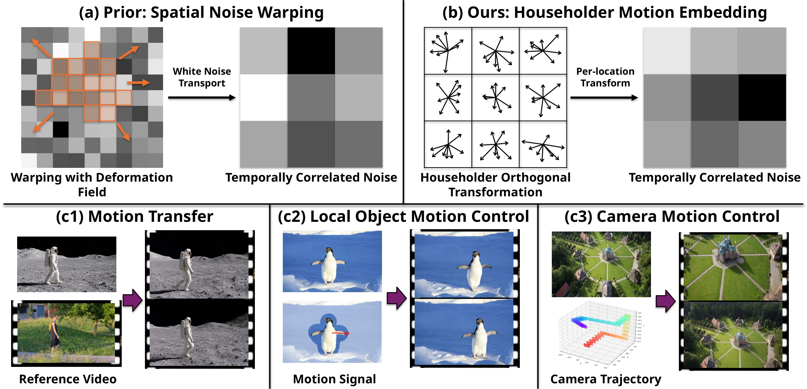
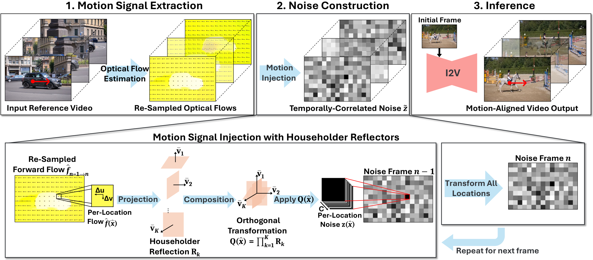

<h1 align="center">Householder Motion Embedding: Noise Modulation for Motion-Controllable Video Generation</h1>

<p align="center"><b>NeurIPS 2026</b></p>

<p align="center">
  Tao Jun Lin<sup>1,2,*</sup> &nbsp;·&nbsp;
  Jinhong Ni<sup>1</sup> &nbsp;·&nbsp;
  Ruyi Zha<sup>1</sup> &nbsp;·&nbsp;
  Yifu Wang<sup>2</sup> &nbsp;·&nbsp;
  Xibin Song<sup>2</sup> &nbsp;·&nbsp;
  Pan Ji<sup>2</sup> &nbsp;·&nbsp;
  Hongdong Li<sup>1,3</sup>
</p>

<p align="center">
  <sup>1</sup>The Australian National University &nbsp;&nbsp;
  <sup>2</sup>Vertex Lab &nbsp;&nbsp;
  <sup>3</sup>Amazon Inc.<br>
  <sup>*</sup>Corresponding author
</p>

<p align="center">
    <a href="https://arxiv.org/abs/2611.07294">arXiv</a> |    <a href="https://github.com/coldsilence507/HouseholderMotionEmbedding-Release">Code</a>
</p>

<p align="center">
  
</p>

<p align="center">
  
</p>

<p align="center"><i>HME generates motion-controlled videos in three stages: (1) optical flow estimation and resampling to the latent grid, (2) temporally correlated noise construction via per-location Householder transformations in channel space, applied frame by frame, and (3) diffusion model fine-tuning and inference.</i></p>

## Abstract

Diffusion models for video generation have achieved remarkable success, yet precise motion control under explicit user guidance remains challenging. Recent noise-warping methods introduce temporal correlations by warping the noise according to the user-provided motion signal. However, standard spatial warping generally disrupts the noise’s i.i.d. Gaussian structure, requiring distribution correction, such as Jacobian-based correction, but at a substantial computational overhead. We propose **Householder Motion Embedding (HME)**, which encodes the motion signal into the noise through a sequence of Householder reflections that together form an orthogonal transformation applied to each location’s channel vector. **HME** exactly preserves the spatial Gaussian structure within each frame while introducing cross-frame correlations that promote temporally consistent video. **HME** is agnostic to the network architecture and integrates directly into standard video diffusion fine-tuning pipelines. Experiments on different scenarios show that **HME** matches or outperforms the state of the art, while achieving a 2.7× speedup over noise warping. These results demonstrate that per-location Householder transformations in channel space offer a principled and efficient alternative to noise warping for motion-controllable video generation.

## Citation

```bibtex
@inproceedings{lin2026hme,
  title     = {Householder Motion Embedding: Noise Modulation for
               Motion-Controllable Video Generation},
  author    = {Lin, Tao Jun and Ni, Jinhong and Zha, Ruyi and Wang, Yifu
               and Song, Xibin and Ji, Pan and Li, Hongdong},
  booktitle = {Advances in Neural Information Processing Systems (NeurIPS)},
  year      = {2026}
}
```

---

<details>
<summary><b>About this repository (project page source)</b></summary>

Static project page, no build step: plain HTML, CSS and JS.

```
index.html              page content (title, authors, abstract, teaser figure, videos, BibTeX)
static/css/style.css    styles (light + dark mode)
static/js/main.js       video comparison viewer, γ slider, copy button
static/images/          Fig. 1 (teaser), Fig. 2 (pipeline, used in this README), social preview image
static/videos/          teaser video + all supplementary comparison clips (H.264 MP4)
```

**Preview locally**

```
python -m http.server 8000
```
Then open http://localhost:8000.

**Publish on GitHub Pages**

1. Create a public GitHub repository and upload the contents of this folder to its root (all files are under GitHub's 100 MB per-file limit).
2. **Settings → Pages → Build and deployment**: Source = *Deploy from a branch*, Branch = `main`, folder = `/ (root)`.
3. The page goes live at `https://<your-username>.github.io/<repo-name>/`.

**Fill in the links**

- Page: in `index.html`, paste the URLs into `href=""` of the buttons with `data-label="arXiv"` and `data-label="Code"`. An empty `href` shows a "soon" badge.
- This README: replace "(coming soon)" in the links line near the top.

**Add or change comparison videos**

Each example lives in `static/videos/<task>/<example>/` with one clip per method (`ref`, `ours`, `ttm`, `gwtf`, `dismo`, `motionpro`, each `.mp4` plus a `.jpg` poster). Tasks are `transfer`, `object` and `camera`; register new examples in the `TASKS` list at the top of `static/js/main.js`. Clips were cut from the supplementary composites (6 × 720 px columns), with the top 32 px removed to drop the burned-in labels:

```
ffmpeg -i composite.mp4 -vf "crop=720:448:<col*720>:32" -an -c:v libx264 -crf 23 -preset slow -pix_fmt yuv420p -movflags +faststart ours.mp4
```

</details>
